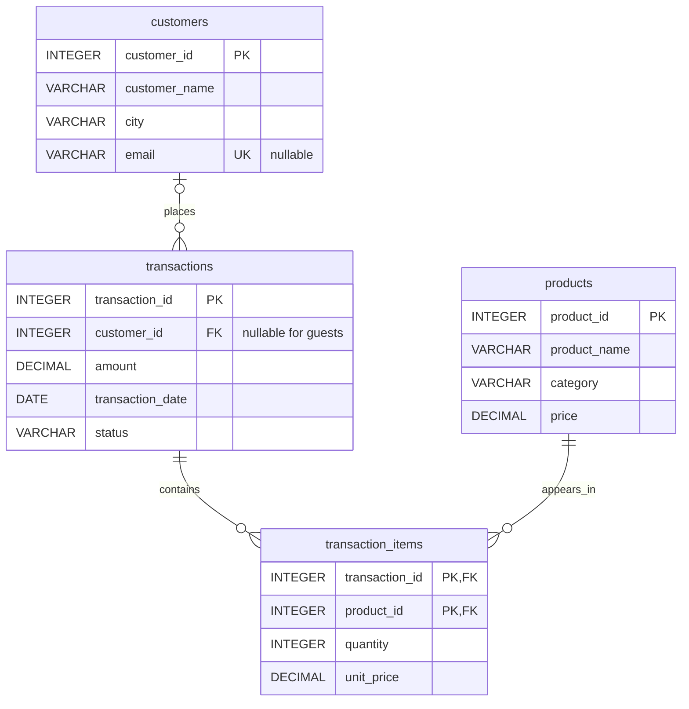

# SQL practice: one online-shop dataset

Start with customers and transactions, then add products and transaction_items when ready. All amounts are USD. The interview question sums recorded transaction amounts across **all statuses**; examples that say completed sales filter status explicitly. Guest transactions have no customer and do not count toward an identified customer's total.

## Setup

From the repository root:

```sh
duckdb interview.duckdb < setup.sql
duckdb interview.duckdb
```

Paste SQL at the prompt; `.quit` exits. **Reset warning:** setup.sql drops and recreates all four teaching tables. Use a dedicated practice database. There is no separate shop setup.

## ERD



A customer has zero or many transactions. A transaction has zero or one customer and zero or many items. Each item references exactly one transaction and one product. Products and transactions form a many-to-many relationship through the item table. Its composite primary key permits each product once per transaction; quantity records multiple units.

## Column rules

| Table | Columns and constraints |
| --- | --- |
| customers | customer_id INTEGER primary key; customer_name and city required VARCHAR; email nullable UNIQUE VARCHAR |
| transactions | transaction_id INTEGER primary key; customer_id nullable INTEGER foreign key; amount required nonnegative DECIMAL(12,2); transaction_date required DATE; status required VARCHAR limited to completed, pending, cancelled |
| products | product_id INTEGER primary key; product_name and category required VARCHAR; price required nonnegative DECIMAL(12,2) |
| transaction_items | (transaction_id, product_id) composite primary key, both foreign keys; quantity required positive INTEGER; unit_price required nonnegative DECIMAL(12,2) |

PK means primary key, FK means foreign key, UK means unique key. Names are not unique. Foreign keys reject nonexistent non-NULL parent IDs but allow NULL where the column is nullable. Prices use exact decimal arithmetic.

`transactions.amount` is the recorded transaction value, not a completed-payment indicator. Item totals equal that value in the seed data, including zero for empty transaction 110, but no cross-table constraint enforces that equality. Historical unit_price can differ from today's products.price. Do not sum transaction amounts after joining items without first accounting for row multiplication.

## Seed data

### customers (6 rows)

| customer_id | customer_name | city | email |
| --- | --- | --- | --- |
| 1 | Alice Chen | Seattle | alice@example.com |
| 2 | Ben Ortiz | Portland | ben@example.com |
| 3 | Cara Singh | Seattle | NULL |
| 4 | Diego Rossi | Austin | diego@example.com |
| 5 | Emma Wilson | Boston | NULL |
| 6 | Alice Chen | Austin | alice6@example.com |

### transactions (10 rows)

| transaction_id | customer_id | amount | transaction_date | status |
| --- | --- | --- | --- | --- |
| 101 | 1 | 600.00 | 2026-01-05 | completed |
| 102 | 1 | 650.00 | 2026-01-10 | completed |
| 103 | 2 | 400.00 | 2026-01-15 | completed |
| 104 | 2 | 600.00 | 2026-02-02 | pending |
| 105 | 3 | 250.00 | 2026-02-05 | cancelled |
| 106 | 3 | 500.00 | 2026-02-08 | completed |
| 107 | 4 | 1000.01 | 2026-02-12 | completed |
| 108 | 6 | 100.00 | 2026-03-01 | completed |
| 109 | NULL | 25.00 | 2026-03-03 | completed |
| 110 | NULL | 0.00 | 2026-03-04 | pending |

### products (7 rows)

| product_id | product_name | category | price |
| --- | --- | --- | --- |
| 1 | Monitor | Electronics | 320.00 |
| 2 | Keyboard | Electronics | 100.00 |
| 3 | Desk | Furniture | 650.00 |
| 4 | Chair | Furniture | 250.00 |
| 5 | Notebook | Stationery | 5.00 |
| 6 | Gift card | Gifts | 1000.01 |
| 7 | Desk lamp | Home | 30.00 |

### transaction_items (10 rows)

| transaction_id | product_id | quantity | unit_price |
| --- | --- | --- | --- |
| 101 | 1 | 2 | 300.00 |
| 102 | 3 | 1 | 650.00 |
| 103 | 1 | 1 | 300.00 |
| 103 | 2 | 1 | 100.00 |
| 104 | 1 | 2 | 300.00 |
| 105 | 4 | 1 | 250.00 |
| 106 | 4 | 2 | 250.00 |
| 107 | 6 | 1 | 1000.01 |
| 108 | 2 | 1 | 100.00 |
| 109 | 5 | 5 | 5.00 |

Alice IDs 1 and 6 are different people. Emma has no transactions. Ben totals exactly $1,000. Transactions 109 and 110 are guests; 110 has no items. Desk lamp has never been ordered. Two customer emails are NULL.

## Questions

Write queries before opening [the answer key](ANSWERS.md). Use explicit `ORDER BY` clauses to make results predictable. Each question is independent. Question 49 rolls back its practice changes.

### Level 1: selecting and filtering

**1. First SELECT.** Return every column and row in customers, ordered by customer ID.

**2. Choose columns.** Return only transaction IDs and amounts, ordered by transaction ID.

**3. Filter one customer.** Find customer ID 2.

**4. Filter amounts.** List transactions strictly above $500, ordered by amount and then transaction ID.

**5. Aliases and arithmetic.** Show each transaction amount and its amount plus a 5% fee, rounded to two decimals. Name the calculated column amount_with_fee.

**6. Sorting and LIMIT.** Find the three largest transactions. Break ties by transaction ID.

**7. IN and BETWEEN.** Find transactions for customer IDs 1 or 2 with amounts between $400 and $600 inclusive.

**8. Text matching.** Find customers whose names start with Alice, using LIKE.

**9. DISTINCT.** List distinct customer names alphabetically. Does this tell you how many customers there are?

### Level 2: counting and aggregation

**10. COUNT.** Return the number of customers, then the number of transactions, as two separate queries.

**11. Distinct counts.** In one query, count transactions and count customers who have transactions.

**12. Basic aggregates.** Find the sum, minimum, maximum, and average transaction amount. Round the average to two decimals.

### Level 3: joins and missing matches

**13. INNER JOIN.** List transactions with matching customers, showing customer ID, customer name, and amount. Explain which transactions are excluded.

**14. LEFT JOIN.** List every customer and any matching transaction IDs and amounts. Preserve customers without transactions.

**15. Find missing matches.** Use LEFT JOIN to find customers with no transactions.

**16. RIGHT and FULL joins.** Rewrite question 14 using RIGHT JOIN. Then use FULL OUTER JOIN and explain which extra rows it returns compared with the left join.

### Level 4: grouping and filtering groups

**17. GROUP BY.** Return the transaction count and total amount per customer ID, using only transactions.

**18. Group joined data.** Return each customer ID and name with their transaction count and total, including zeroes for customers without transactions.

**19. HAVING: the interview question.** Return each customer's total transaction amount, including only customers with totals above $1,000. Show customer ID and name; sort by total descending.

**20. Multiple group conditions.** Find customers with at least two transactions and a total of at least $1,000.

**21. WHERE versus HAVING.** Consider only transactions of at least $500. Among those transactions, return customer IDs whose total is above $1,000. Explain why this differs from question 19.

**22. ON versus WHERE.** List every customer with a count of their transactions above $500, including zero counts. Put the amount filter in the join condition.

### Level 5: conditional logic and subqueries

**23. CASE.** Label each transaction Large if its amount is at least $600, otherwise Small.

**24. Conditional aggregation.** For each customer, count transactions at least $600 and transactions below $600. Include customers with no transactions.

**25. Scalar subquery.** Find transactions above the overall average amount. Compare against the unrounded average.

**26. EXISTS and NOT EXISTS.** Find customers with transactions using EXISTS, then customers without transactions using NOT EXISTS.

**27. CTE and average customer totals.** Use a CTE to calculate every customer total, treating no transactions as zero. Return customers whose totals exceed the average of all six customer totals.

### Level 6: window functions

**28. Window aggregate.** Show each transaction beside its customer total without collapsing transaction rows.

**29. Ranking.** Rank every customer by total amount, highest first, including customers without transactions. Use DENSE_RANK so tied totals would share a rank.

**30. Running totals.** Show a running amount per customer ordered by transaction ID. Use an explicit ROWS window frame. This demonstrates ID order. For a chronological running total, order by transaction_date and transaction_id instead. Guest transactions share a NULL partition; that partition does not identify one person.

## Explain your reasoning

31. Why does grouping only by customer name produce the wrong totals here?
32. After a left join, why does `COUNT(*)` give Emma a count of one, while `COUNT(t.transaction_id)` gives zero?
33. Why can a condition on the right table in `WHERE` remove customers preserved by a left join?
34. Why does `NOT IN (SELECT customer_id FROM transactions)` return no customers here? Show a safe alternative.
35. Why does a full outer join include transactions 109 and 110 without a matching customer? Does a nullable foreign key permit nonexistent non-NULL customer IDs?
36. Which query finds customers with no transactions, and which finds customers with a zero total? Are these always equivalent if zero-amount transactions are permitted?


## Level 7: extending the same dataset

**37. Stored NULLs.** List customers without email, displaying (not supplied), and count all customers versus known emails.

**38. ILIKE and Boolean filters.** Find customers in Seattle or Austin whose names do not start with Diego (case-insensitive).

**39. Dates.** List February transactions with a half-open date range.

**40. Monthly sales.** Report completed transaction counts and amounts by month, including guests.

**41. IN subquery and NULL trap.** Use IN with a subquery to find customers with completed transactions. Then demonstrate the NOT IN NULL trap and fix it.

**42. Three-table join.** List completed transaction items with product names, quantities, historical unit prices, and calculated line totals. Include guest purchases.

**43. Reconcile totals.** Compare every recorded transaction amount with its item total, including transactions with no items.

**44. Sales by category.** Calculate completed item sales for every catalog category, including zero for categories with no completed sales. Use historical prices.

**45. Never ordered.** Find products that have never appeared in any transaction, regardless of status.

**46. Row multiplication.** For completed transactions with items, compare joined item rows, distinct transactions, SUM(transaction amount), and SUM(line total). Explain the inflated sum.

**47. CROSS JOIN.** Generate every combination of distinct product categories and the statuses completed and pending.

**48. Set operations.** Find customer IDs appearing in completed or pending transactions using UNION. Then try UNION ALL, INTERSECT, and EXCEPT. Exclude guests in each input.

**49. Reversible data changes.** In one transaction, insert customer 99, update their city, select them, delete them, and roll back. Use explicit column lists.

